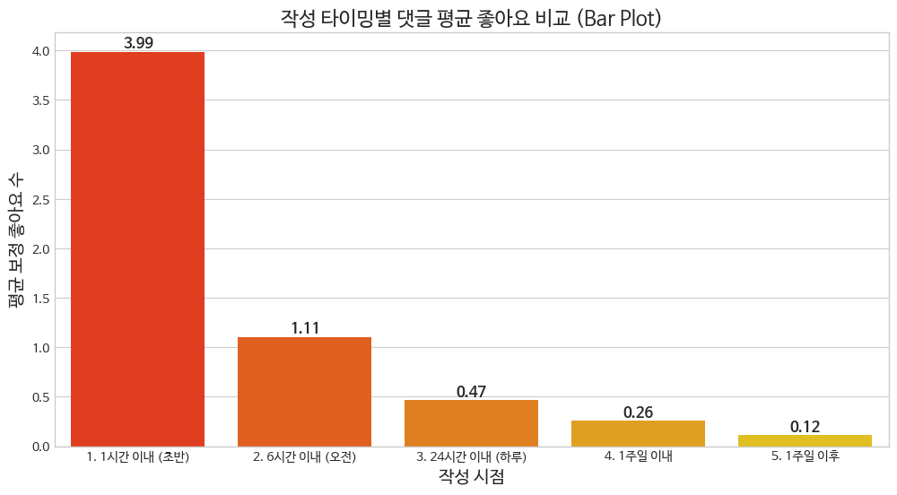
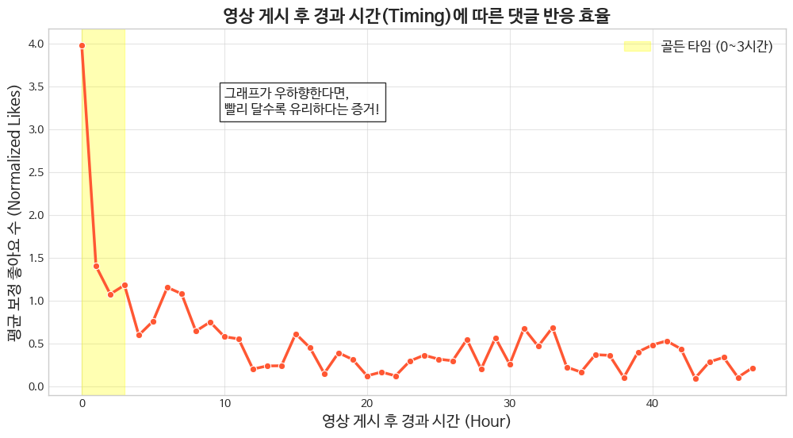
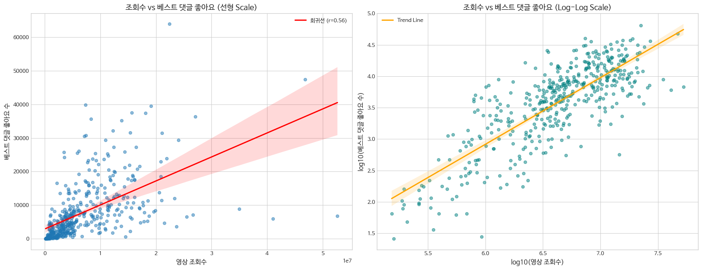
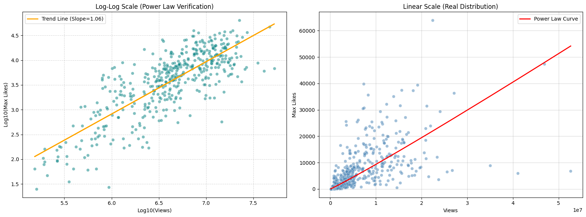
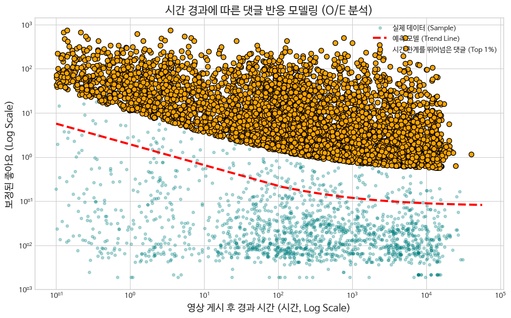

# 편향 보정

## 문제

댓글 좋아요 수는 댓글 품질의 직접적인 label이 아니다. 특히 YouTube Shorts 댓글에서는 다음 편향이 강하게 작동한다.

1. **조회수 규모 편향**
   - 조회수가 높은 영상은 댓글이 노출될 기회가 많다.
   - 서로 다른 영상의 댓글 좋아요 수를 절대값으로 비교하면 조회수 높은 영상의 댓글이 유리하다.

2. **작성 시점 편향**
   - 영상 업로드 직후 작성된 댓글은 더 오래 노출된다.
   - 늦게 달린 댓글은 내용이 좋아도 좋아요를 받을 시간이 적다.

3. **노출 위치 편향**
   - 초반 좋아요가 많은 댓글은 상단에 노출되며 추가 좋아요를 얻는다.
   - 이 변수는 API로 직접 관측하기 어렵다.

이 프로젝트에서는 관측 가능한 변수인 `video view count`와 `comment timing`을 이용해 편향을 근사적으로 보정했다.

## 관찰된 데이터 근거

발표자료와 실험 notebook에서 확인한 핵심 관찰은 다음과 같다.

| 분석 항목 | 관찰 결과 | 해석 |
| --- | ---: | --- |
| 좋아요 수와 영상 관련성의 상관 | 0.085 | 좋아요 수만으로는 영상 맥락 적합성을 설명하기 어려움 |
| 영상 조회수와 베스트 댓글 좋아요의 Spearman 상관 | 0.7598 | 조회수 규모가 댓글 좋아요 획득 기회에 강하게 관여 |
| 영상 조회수 scale model의 결정 계수 | R^2 = 0.6344 | 조회수만으로도 댓글 좋아요 변동의 상당 부분을 설명 |
| 1시간 이내 작성 댓글 평균 보정 좋아요 | 3.99 | 초기 작성 댓글의 노출 이점이 매우 큼 |
| 1주일 이후 작성 댓글 평균 보정 좋아요 | 0.12 | 늦은 댓글은 반응 기회가 급격히 줄어듦 |

아래 그래프들은 원본 실험 notebook의 저장된 출력에서 추출했다.





## 조회수 보정

영상 조회수와 댓글 좋아요 수는 선형 관계라기보다 scale effect를 가진다. 따라서 멱법칙 형태의 기대 좋아요 수를 사용했다.

```text
ExpectedLikesByViews = 10^beta * Views^alpha
```

실험에서 사용한 파라미터는 다음과 같다.

```text
alpha = 1.0578
beta  = -3.4334
```

댓글의 조회수 보정 점수는 다음처럼 계산한다.

```text
ViewCorrectedScore = ActualLikes / ExpectedLikesByViews
```

이 값은 "영상 조회수 규모를 고려했을 때, 해당 댓글이 기대보다 얼마나 잘 반응을 얻었는가"를 의미한다.

실험에서는 453개 영상의 조회수와 베스트 댓글 좋아요 수를 비교했다. 선형 scale에서는 분산이 크지만, log-log scale에서는 멱법칙 관계가 더 뚜렷하게 나타났다.





## 시간 보정

영상 업로드 후 댓글 작성까지 걸린 시간이 짧을수록 댓글은 더 긴 노출 시간을 얻는다. 이를 보정하기 위해 시간 감쇄 곡선을 사용했다.

```text
TimeAdvantage = a * t^(-b) + c
```

실험에서 사용한 파라미터는 다음과 같다.

```text
a = 1.65
b = 0.53
c = 0.08
```

여기서 `t`는 영상 게시 후 댓글 작성까지 걸린 시간이다. 너무 작은 시간값에서 값이 폭발하지 않도록 최소 시간 하한을 둔다.

시간 보정 점수는 다음처럼 계산한다.

```text
TimeCorrectedScore = ActualLikes / TimeAdvantage
```

시간 감쇄 모델은 약 488,416개 댓글을 대상으로 curve fitting을 수행해 얻었다. 분석 결과 댓글 반응 효율은 초반에 급격히 높고, 시간이 지날수록 완만하게 낮아지는 멱감쇄 형태를 보였다.



## 최종 preference proxy

최종적으로는 조회수와 시간의 영향을 함께 보정한다.

```text
PreferenceProxy =
    ActualLikes / (ExpectedLikesByViews * TimeAdvantage)
```

실제 구현에서는 다음 순서로 학습 데이터를 골랐다.

1. 조회수 5,000회 미만 영상과, 수집 시점 기준 노출 24시간 미만 댓글은 제외
2. `PreferenceProxy`가 기대치의 1% 미만인 댓글은 제외하고, 영상당 상위 20개를 후보로 선정
3. 멀티모달 LLM judge가 후보마다 영상-댓글 관련성 점수(0-100)를 부여
4. `(관련성 점수, PreferenceProxy)` 순으로 정렬해 영상당 10개를 최종 선정

관련성 점수는 PreferenceProxy에 곱하지 않고, 정렬의 1순위 기준으로 사용했다.

이 점수는 실제 사용자 선호를 완벽히 나타내지 않는다. 대신 raw like count보다 학습 label로 쓰기 나은 근사값을 목표로 한다.

## 한계

이 보정은 다음 한계를 갖는다.

- 실제 댓글 노출량을 알 수 없다.
- 댓글 위치 변화와 추천 알고리즘의 영향을 모델링할 수 없다.
- 채널별 팬덤 규모, 주제 민감도, 영상 업로드 시간대는 충분히 반영하지 못했다.
- "관련성은 낮지만 밈적으로 인기 있는 댓글" 같은 사례를 완전히 처리하기 어렵다.

따라서 이 보정 점수는 정답 label이 아니라, **불완전한 공개 데이터에서 사용자 선호를 근사하기 위한 proxy score**로 이해해야 한다.
